# KEYMART – a marketplace for digital game keys

> Built for the **Eneba Intern Assignment 2027**: a marketplace that looks and works like [eneba.com](https://www.eneba.com/lt/): browse and search games, compare offers from several sellers, pay with Stripe (test mode) and receive a digital key. "KEYMART" is a placeholder brand name; no real money moves and no real game keys are sold.

| | |
|---|---|
| **Frontend** | React 19 + TypeScript + Vite, Redux Toolkit + Redux Saga, Axios, React Router, React Hook Form + zod, SCSS modules, Lucide |
| **Backend** | PHP 8.3, Slim 4, PHP-DI, PDO (prepared statements only), JWT in an HttpOnly cookie |
| **Data** | MySQL 8 / MariaDB (Railway MySQL in production, XAMPP locally) |
| **Payments / e-mail** | Stripe (test mode only) · EmailJS |
| **Run / ship** | Docker, GitHub Actions CI, Vercel (frontend) + Railway (API and database) |

## Screenshots

| | |
|---|---|
| **Homepage**: banner, category shortcuts, recently viewed, recommended, best sellers, deals, new releases, upcoming (all fed by the database)<br>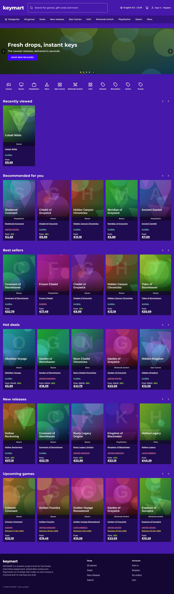 | **Store**: filters, sort and pagination live in the URL<br>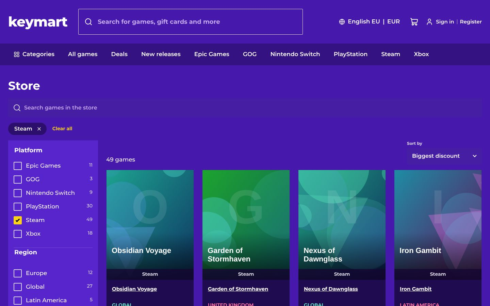 |
| **Product page**: breadcrumbs, buy box, offers from several sellers<br>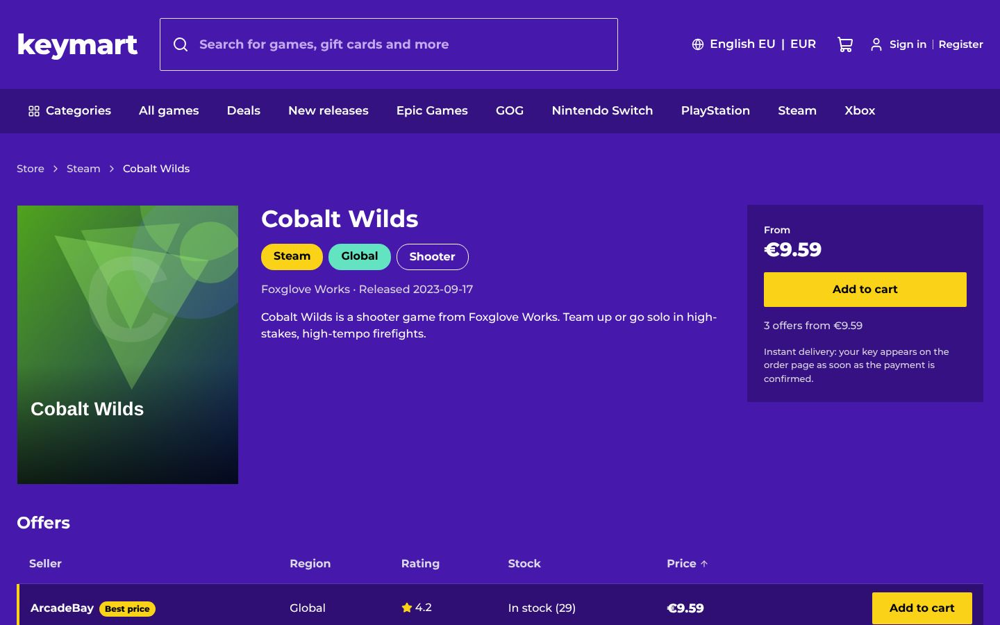 | **Cart panel**: opens from the header icon, works for visitors and buyers<br>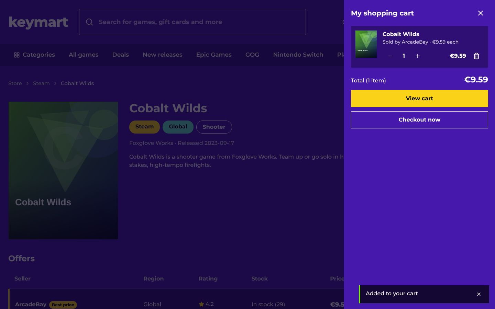 |
| **Checkout**: server-side summary, Stripe payment, reduced checkout header<br>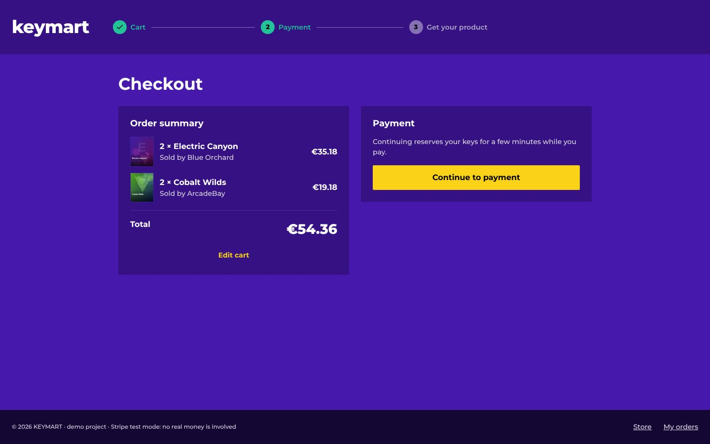 | **Orders**: history with paid status; keys are revealed on the order page<br>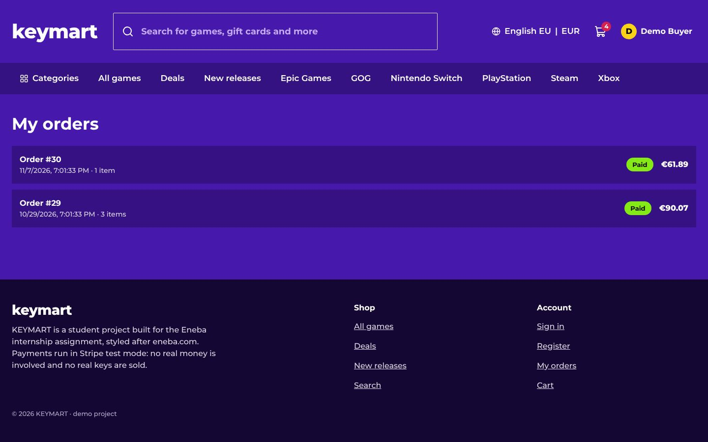 |
| **Account**: edit profile, change password<br>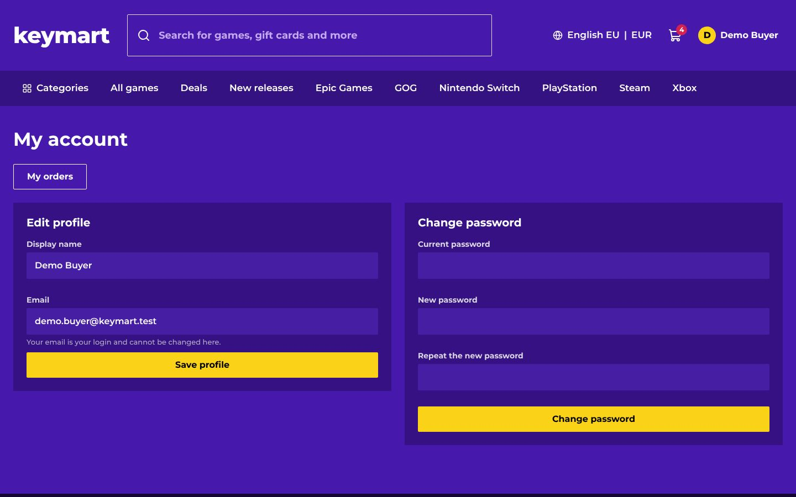 | **Language and currency** (display currency; the card is charged in EUR)<br>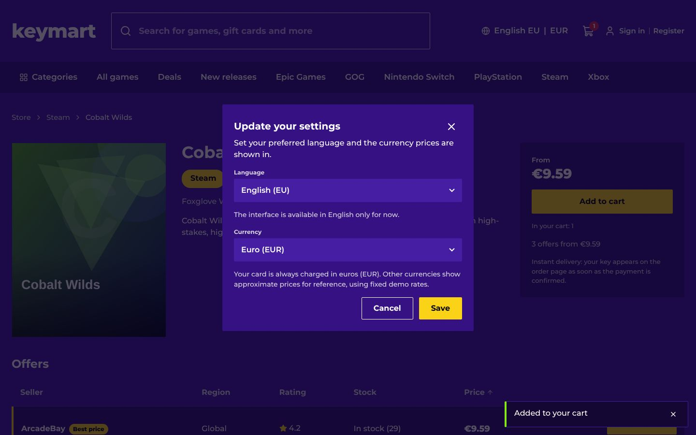 |
| **Phone**<br> | A before/after comparison with the reference recording: [docs/screens/DIFFERENCES.md](docs/screens/DIFFERENCES.md) |

Regenerate with `cd frontend && NODE_PATH=$(npm root -g) node e2e/readme.screens.cjs` (API and `npm run dev` running with the demo data).

## What it does

- **Homepage** assembled from `home_blocks` rows: switch a block off or reorder it in the database and the page changes with no frontend change. Sections: banner, category shortcuts, recently viewed (kept in the browser), recommended, best sellers, deals, new releases, upcoming games.
- **Store**: filters (platform, region, genre, price range), sort (popular, price, newest, discount), pagination and a search box; the whole state is in the URL, so a reload reproduces the view. Typo-tolerant search with "did you mean" and live suggestions.
- **Product page** with offers from several sellers, stock and best-price markers. Out-of-stock games are listed, not hidden.
- **Cart**: visitors keep a cart in the browser (merged into the account when they sign in, without duplicates); buyers have a server-side cart. A panel on the header icon plus a full cart page. Quantities are limited by the keys that really exist.
- **Checkout** (sign-in required): the server re-reads prices and stock, reserves the keys for 15 minutes in one transaction, creates the Stripe PaymentIntent for the **server's** total, and delivers keys when the payment is confirmed (by webhook or by asking Stripe directly).
- **Accounts**: register, sign in, e-mail verification link, edit profile, change password, order history, two demo accounts.
- **Observability**: a structured JSON log with request ids for every flow, readable on Vercel/Railway ([docs/LOGGING.md](docs/LOGGING.md)).
- Eneba-style theme from design tokens, responsive, axe-checked accessibility.

## Architecture

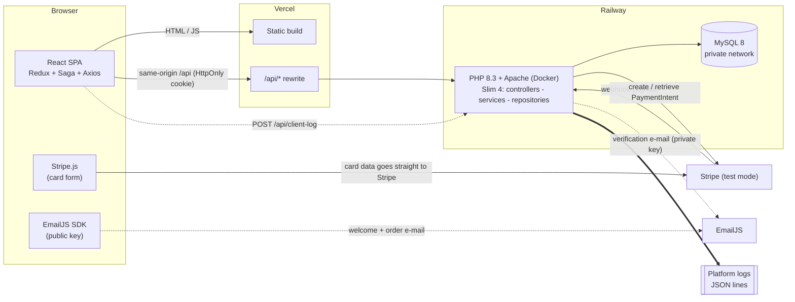

**Rules the design is built on**
- The browser only ever talks to the HTTPS API on its own origin; it never reaches MySQL and receives no credential. The session is an HttpOnly cookie, state-changing requests also need an `X-Requested-With` header and an allowed `Origin` (CSRF).
- **The server owns money and stock.** The client never sends a price or an amount: cart and checkout recompute from the database inside a transaction, and Stripe is asked for exactly that total.
- **Keys are inventory.** Encrypted at rest (libsodium), one row per key, `available -> reserved -> sold`, locked with `FOR UPDATE SKIP LOCKED` so two buyers never get the same key and nobody waits.
- **Payment confirmation is server-verified** and idempotent: the Stripe webhook (signature-checked) and a server-to-server lookup both end in the same routine; an already paid order is a no-op.
- Frontend: feature folders own slice, saga, service and types; components never call the API, they dispatch and select.

**A purchase, end to end**

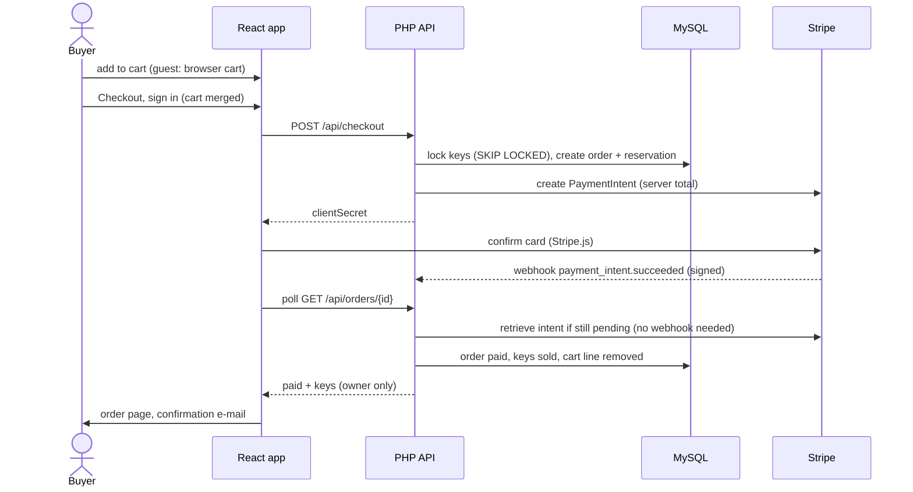

## Scope: what is in, what is out, and why

| Area | Status | Justification |
|---|---|---|
| Store: list, filter, sort, paginate, URL as state | **In** | Core requirement; filters are SQL `WHERE`s and the URL makes every view shareable and reload-safe. |
| Search: typo tolerant, suggestions, "did you mean" | **In** | Explicit requirement; done server-side (LIKE candidates + trigram/Levenshtein scoring in PHP) so it behaves the same on every page. A real search engine is the stated production recommendation ([docs/SEARCH.md](docs/SEARCH.md)). |
| Homepage as config-driven blocks | **In** | Explicit requirement: each block has its own endpoint and rows in `home_blocks`; nothing is hard-coded in the frontend. |
| Recently viewed | **In (browser-side)** | Only the visitor's browser knows it; slugs are stored locally and the catalogue supplies fresh cards. Nothing personal is kept on the server. |
| Recommended for you | **Partial** | Same list for everyone (popularity per euro). True personalisation needs behaviour data the shop does not collect. |
| Product page with multi-seller offers | **In** | The offer, not the product, is what is bought. |
| Cart for visitors and buyers, merge on sign-in | **In** | Guests keep a browser cart (no server rows for strangers); the server re-checks stock and limits at merge and at checkout. |
| Checkout, Stripe PaymentIntent, webhook, key delivery | **In** | The riskiest flow: gets transactions, idempotency, a failure matrix and the most tests ([docs/CHECKOUT.md](docs/CHECKOUT.md)). |
| Auth, e-mail verification, profile, change password, order history | **In** | Required for checkout and orders. Verification is **not enforced** (a banner only): it would block demo accounts for no gain here. The verification link is created and mailed by the API because it is a secret. |
| Password reset | **Out** | A reset link is a secret and needs a trusted mail path per user; verification already shows that path, a reset flow is the same work again. |
| Keys encrypted at rest, one-time delivery | **In** | A database dump must not leak sellable keys. |
| Eneba styling from design tokens | **In** | Required; one token set drives every screen ([docs/DESIGN_TOKENS.md](docs/DESIGN_TOKENS.md)). |
| Language and currency settings | **Partial** | Display currency (EUR, USD, GBP, AED) uses fixed demo rates and the card is always charged in EUR; the interface is English only because there is no i18n layer. Real rates and translations are separate tasks. |
| Structured logging and request tracing | **In** | Added so a silent failure (an e-mail, a webhook) can be diagnosed from the deployment's logs alone. |
| Seller dashboard, key upload UI | **Out** | Sellers and keys come from the seeder and `bin/import_keys.php`; the buyer side is what the assignment judges. |
| Admin panel, product CRUD | **Out** | Seed data demonstrates every flow; there are no admin roles, routes or tables. |
| Reviews, wishlist, cashback, gift-card categories, coupons, taxes, shipping | **Out** | No bearing on the core flow and a large UI cost; the shop sells digital keys, so there is nothing to ship. |
| Refund UI, disputes | **Out** | The backend refunds automatically in the one failure path (paid but undeliverable) and logs `payment.refund_failed` when it cannot. |
| Real microservices for homepage blocks | **Out** | One PHP app with a module, endpoint and table per block; the seam is real, the infrastructure cost is not worth it. |
| SEO / server-side rendering | **Out** | A single-page app is enough for the assignment; stated as a known limitation. |

## Data model

Generated from the live schema (migrations `backend/database/migrations/001-009`). `PK` primary key, `FK` foreign key, `UK` unique. Prices are integer cents; all times are UTC.

| Group | Tables | Purpose |
|---|---|---|
| Accounts | `users`, `email_verifications`, `login_attempts`, `rate_limits` | credentials (Argon2id), verification tokens (only a hash is stored), sign-in throttling and abuse limits |
| Catalogue | `platforms`, `regions`, `products`, `sellers`, `offers`, `deals`, `product_stats` | what is sold, by whom, at what price; `product_stats` feeds best sellers and popularity; covers are generated SVGs stored on the product |
| Inventory | `game_keys` | one row per key: encrypted value, SHA-256 fingerprint (unique), status, owning order, reservation deadline, `sold_at` |
| Orders | `cart_items`, `orders`, `order_items`, `stripe_events` | the server-side cart, orders with their status, an immutable snapshot of what was bought, processed Stripe event ids (idempotency) |
| Site | `banners`, `home_blocks`, `schema_migrations` | homepage content and layout, applied migrations |

<details>
<summary>Entity-relationship diagram (all columns)</summary>

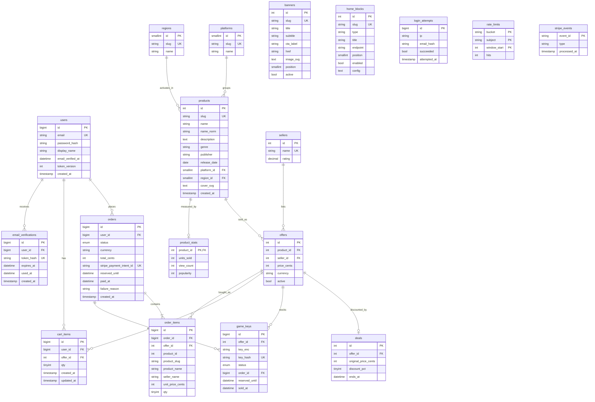

</details>

Order status: `pending` -> `paid` | `failed` | `expired` | `canceled`; a payment that cannot be delivered goes `refund_needed` -> `refunded`. Key status: `available` -> `reserved` (order, deadline) -> `sold` (order, `sold_at`), or back to `available` when the order is closed. More: [docs/KEYS.md](docs/KEYS.md), [docs/CHECKOUT.md](docs/CHECKOUT.md).

## Run it locally

**Docker**: `docker compose up --build`, then http://localhost:5173 (app), http://localhost:8080/api/health (API), MySQL on `localhost:3307`. The API container migrates and seeds on first start. Reset: `docker compose down -v`.

**XAMPP / plain PHP** (PHP 8.2+ with `pdo_mysql`, Composer, MySQL 8 or MariaDB 10.4+, Node 22; details in [docs/XAMPP.md](docs/XAMPP.md)):
```bash
cd backend && cp .env.example .env && composer install      # XAMPP: copy .env.xampp.example instead
php bin/setup.php     # creates the database if missing, migrates, loads demo data and the demo accounts
php bin/doctor.php    # checks PHP, secrets, database, migrations, game keys and says what to fix
php -S localhost:8080 -t public public/index.php

cd frontend && cp .env.example .env && npm install && npm run dev      # second terminal
```
Open http://localhost:5173 (use `localhost`, not `127.0.0.1`: the CSRF origin list names `localhost`).

**Demo accounts** (created by the seeder, e-mail verified, each with paid orders; public on purpose, their password cannot be changed because the accounts are shared):

| Email | Password |
|---|---|
| `demo.buyer@keymart.test` | `Demo-Buyer-2027` |
| `demo.shopper@keymart.test` | `Demo-Shopper-2027` |

**Configuration** is environment variables only (`backend/.env.example`, `frontend/.env.example`, root `.env.example`); real `.env` files are git-ignored.

| Where | Settings | Purpose |
|---|---|---|
| API | `DB_*` or `MYSQL_*` or Railway's `MYSQL_URL` (individual variables win); `JWT_SECRET`, `KEY_ENCRYPTION_KEY`, `APP_URL`, `COOKIE_SECURE`, `APP_ENV` | database, sessions, key encryption, CSRF origin; a deployment refuses to start with a missing or published secret |
| API | `STRIPE_SECRET_KEY`, `STRIPE_WEBHOOK_SECRET` | create and verify payments |
| API | `EMAILJS_*` (with the private key) | verification e-mail |
| API | `RUN_MIGRATIONS`, `SEED_ON_START` | the container start step (defaults: on) |
| API | `LOG_LEVEL` | `debug`/`info`/`warn`/`error`/`off` |
| Frontend (build time) | `VITE_STRIPE_PUBLISHABLE_KEY`, `VITE_EMAILJS_*` | Stripe's Payment Element; welcome and order e-mail |

Locally run `stripe listen --forward-to localhost:8080/api/webhooks/stripe` for the `whsec_...`, then pay with card `4242 4242 4242 4242`, any future date, any CVC.

## Game keys

`php bin/seed.php` is idempotent and creates keys only for offers that have none; it never refills a sold-out offer and never re-encrypts. **With no available key every game shows "Out of stock"** and `GET /api/health` reports `"stock":"empty"`. Real keys: `php bin/import_keys.php <offer id> <file>`. Diagnosing or seeding a deployed database from your computer: [docs/KEYS.md](docs/KEYS.md).

## Deployment

Frontend on Vercel, the API as a Docker image on Railway (it migrates and seeds on start), MySQL on Railway reached over its **private network** (`MYSQL_URL=${{ MySQL.MYSQL_URL }}` on the API service), Stripe in test mode. Step by step, environment tables per service, webhook registration, free-tier cold starts and warm-up: [docs/DEPLOY.md](docs/DEPLOY.md), [docs/RAILWAY.md](docs/RAILWAY.md). Health: `GET /api/health` -> `{"status":"ok","db":"ok","stock":"ok"}`.

## Logging and troubleshooting

Every flow writes JSON lines with a level, an event name and a request id. Example for a refused sign-in and a failed verification e-mail:
```json
KEYMART {"ts":"...","level":"warn","event":"auth.login.failed","msg":"sign-in refused: invalid_credentials","request_id":"99e5aa24a8f97662","reason":"invalid_credentials","email":"g***@example.com"}
KEYMART {"ts":"...","level":"error","event":"mail.verification.failed","msg":"EmailJS refused the verification e-mail","http_status":403,"provider_answer":"API calls are disabled for non-browser applications"}
```
Search the event name, the level or a `request_id` in *Vercel > Logs* / *Railway > Logs*. The browser reports what only it can see (the e-mail it sends, a payment page that gave up) as `browser.*` events. Full catalogue, secrets policy and "what to search when X": [docs/LOGGING.md](docs/LOGGING.md).

| Symptom | Search / do |
|---|---|
| Every game "Out of stock" | `health.stock.empty`; seed ([docs/KEYS.md](docs/KEYS.md)) |
| "Confirming your payment…" never ends | `checkout.intent` -> `payment.sync.*` -> `webhook.rejected` / `webhook.received` -> `payment.paid` |
| No e-mail | `browser.email.*` (order / welcome), `mail.verification.*` (verification) |
| "Database is not reachable" | `db.unreachable`, [docs/RAILWAY.md](docs/RAILWAY.md) |
| 403 on every POST | `security.csrf.rejected` (is `APP_URL` exactly the browser's address?) |
| Anything on a developer machine | `php bin/doctor.php` |

## Tests and CI

```bash
cd backend  && composer install && vendor/bin/phpunit                               # needs a keymart_test database (or TEST_DB_NAME)
cd frontend && npm run format:check && npm run lint && npm test && npm run build    # Vitest + Testing Library
cd frontend && npx playwright install chromium && npm run test:e2e                  # real browser, starts API and Vite itself
```
`.github/workflows/ci.yml` runs on every push: PHPUnit on MySQL 8 (and loads `railway_import.sql` into an empty MySQL), the frontend checks, a job that builds the Docker image and starts it like production, and the Playwright flows (browse, guest cart, cart panel, demo account, full purchase). Concurrency, payment confirmation, key inventory, logging and the secrets policy each have their own tests.

## API quick reference

Errors always look like `{ "error": { "code", "message", "details" } }`. State-changing requests need the session cookie and `X-Requested-With: fetch`.

| Area | Endpoints |
|---|---|
| Catalogue | `GET /api/products` (`platform[]`, `region[]`, `genre[]`, `price_min/max`, `slug[]`, `q`, `sort`, `page`), `/api/products/{slug}`, `/api/filters`, `/api/search`, `/api/search/suggest` |
| Homepage | `/api/home/layout` + `banners`, `categories`, `recommended`, `best-sellers`, `deals`, `new-releases`, `upcoming` |
| Auth | `POST /api/auth/register`, `login`, `logout`, `verify-email`, `resend-verification`, `change-password`; `PATCH /api/auth/profile`; `GET /api/auth/me` |
| Cart / orders | `/api/cart` (+ `/{offerId}`), `POST /api/checkout`, `GET /api/orders`, `/api/orders/{id}` (keys only for the owner of a paid order) |
| Other | `POST /api/webhooks/stripe` (signature, no cookie), `POST /api/client-log`, `/api/images/...`, `/api/health` |

## Known limitations

- The interface is English only; display currencies use fixed demo rates and the card is charged in EUR.
- "Recommended for you" is not personalised.
- Verification e-mail needs the API's EmailJS private key; welcome and order e-mails are sent by the browser and need the `VITE_EMAILJS_*` variables at build time.
- Search is PHP-side scoring over a candidate set: fine for hundreds of products, not for millions ([docs/SEARCH.md](docs/SEARCH.md)).
- Free-tier hosting sleeps after inactivity (first request takes up to a minute; see the warm-up note in [docs/DEPLOY.md](docs/DEPLOY.md)).
- No admin or seller interface; keys are loaded with scripts.

## Documentation map

| Topic | File |
|---|---|
| Scope decisions, API, payment flow, risks | [docs/ARCHITECTURE.md](docs/ARCHITECTURE.md) |
| Frontend structure, state, testing | [docs/FRONTEND.md](docs/FRONTEND.md) |
| Design tokens, comparison with the reference | [docs/DESIGN_TOKENS.md](docs/DESIGN_TOKENS.md), [docs/screens/DIFFERENCES.md](docs/screens/DIFFERENCES.md) |
| Cart, checkout, Stripe, concurrency | [docs/CHECKOUT.md](docs/CHECKOUT.md) |
| Game keys, seeding a deployed database | [docs/KEYS.md](docs/KEYS.md) |
| Homepage blocks, language and currency | [docs/HOME_BLOCKS.md](docs/HOME_BLOCKS.md) |
| Search, query plans | [docs/SEARCH.md](docs/SEARCH.md), [docs/QUERY_PLANS.md](docs/QUERY_PLANS.md) |
| E-mail templates, verification, demo accounts | [docs/EMAIL.md](docs/EMAIL.md), [docs/email-templates/](docs/email-templates/) |
| Logging | [docs/LOGGING.md](docs/LOGGING.md) |
| Deployment | [docs/DEPLOY.md](docs/DEPLOY.md), [docs/RAILWAY.md](docs/RAILWAY.md), [docs/XAMPP.md](docs/XAMPP.md) |
| Security review | [docs/REVIEW.md](docs/REVIEW.md) |
| AI usage | [CLAUDE.md](CLAUDE.md) (project rules), per-task prompt and summary in [docs/ai-log/](docs/ai-log/), full chat in [docs/CHAT_HISTORY.md](docs/CHAT_HISTORY.md) |

## Repository layout

```
backend/    PHP API: public/, config/, src/{Controllers,Services,Repositories,Home/Blocks,Mail,Payment,Middleware,Support},
            database/{migrations,seeds,railway_import.sql}, bin/ (setup, migrate, seed, doctor, import_keys), tests/, Dockerfile
frontend/   React app: src/{app,components,features,services,styles}, e2e/ (Playwright)
docs/       documentation, screenshots (docs/screens), the per-task AI log (docs/ai-log)
.github/    CI workflow
docker-compose.yml   local stack     vercel.json   Vercel project configuration
```
