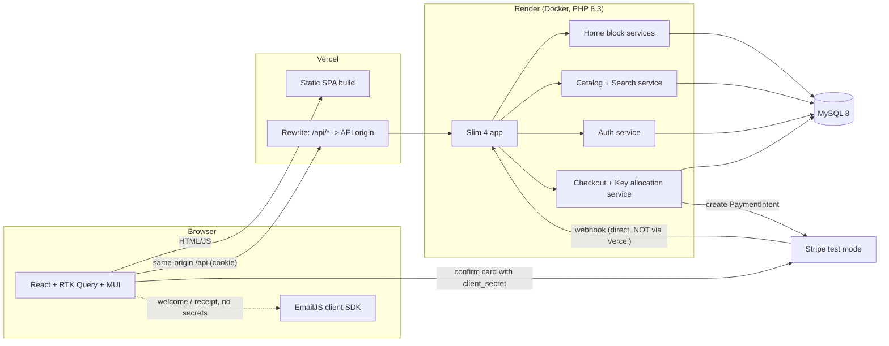
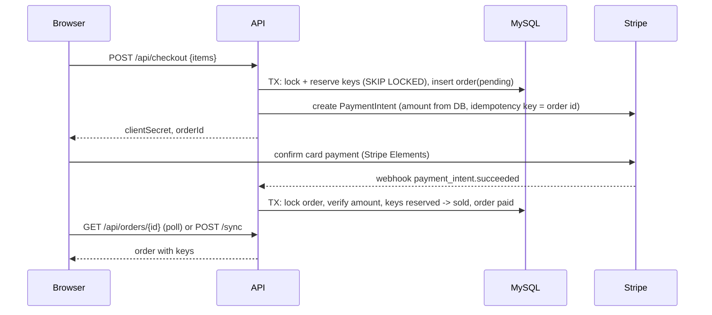

# Architecture

Principle from the brief: **a few features done extensively beat many minimal ones.** So the core
purchase path (search -> product -> cart -> pay -> key) is built to be correct and explainable; everything
around it is cut or stubbed on purpose.

Decisions taken as given: Slim 4, PDO, JWT in an httpOnly cookie via Vercel rewrite, Stripe
PaymentIntent + webhook, EmailJS only for non-secret emails, LIKE + PHP trigram/Levenshtein search.
Where I disagree or tightened them, it is flagged with **CHALLENGE** and summarised in section 9.

---

## 1. Scope

| Area | Status | Justification |
|---|---|---|
| Store: list, filter (platform, region, price), sort, paginate, name search | **In** | Core requirement; filters are SQL `WHERE`s, cheap to do well. |
| Homepage as config-driven blocks (banner, best sellers, deals, new releases) | **In** | Explicit requirement and the best place to show architecture. |
| Fuzzy search + live suggestions | **In** | Explicit; done server-side so it works the same from every page. |
| Product page with multi-seller offer comparison | **In** | Core of a marketplace; offers are the unit that is bought. |
| Cart (client-side) with server-side re-pricing | **In** | Guests can fill a cart; the server never trusts client prices. |
| Checkout, Stripe PaymentIntent + webhook, key delivery | **In** | The most valuable and riskiest flow; gets the most care and tests. |
| Auth: register, login, logout, me, protected routes | **In** | Required; checkout and orders need identity. |
| Order history with revealed keys | **In** | Required by the flow ("Order and key"). |
| Eneba styling via a MUI theme (dark palette, typography, cards, buttons) | **In** | Required; centralised in one theme so it applies to every screen. |
| Keys encrypted at rest (libsodium) | **In** | Small cost, large credibility: a DB dump should not leak sellable keys. |
| Backend integration tests for allocation/concurrency | **In** | The one place where bugs lose money; worth the time. |
| Seller dashboard / key upload | **Out** | Sellers and keys come from a seed script; the buyer side is what is judged. |
| Admin panel, product CRUD | **Out** | Same: seed data is enough to demonstrate everything. |
| Password reset, email verification | **Out** | Reset links are secrets, so EmailJS cannot carry them (see 4); no safe cheap channel. |
| Reviews, wishlist, loyalty, gift cards, coupons | **Out** | No bearing on the core flow; high UI cost. |
| Multi-currency, i18n | **Out** | Single currency (EUR, integer cents) removes a whole class of rounding bugs. |
| Refund UI, disputes | **Out** | Backend can refund automatically in one failure path (see 5); no UI. |
| Real microservices for homepage blocks | **Out** | One PHP app, separate modules/endpoints/tables per block (see 6); infra cost is not worth it. |
| Server-side cart | **Out** | Client cart + `/cart/quote` is fewer endpoints and tables; see question 3. |
| SEO / SSR | **Out** | SPA on Vercel is fine for an assignment; stated as a known limitation. |

---

## 2. System diagram



Key points: the browser only ever talks to its own origin (`/api`), so the cookie is first-party and CORS
is unnecessary. The Stripe webhook goes **directly** to the API origin (it has no cookie, needs the raw
body for signature verification, and must not depend on a proxy). Local dev uses a Vite proxy to mimic the rewrite.

---

## 3. REST API

Conventions: JSON, prices as integer cents + `currency: "EUR"`, errors as
`{ "error": { "code": "string", "message": "string", "details"?: {} } }`, pagination as
`{ items, page, pageSize, total }`. Auth column: `-` public, `U` needs cookie. All state-changing
requests require header `X-Requested-With: fetch` (CSRF, see 4).

**Types** (abridged)
`ProductCard = { id, slug, name, coverUrl, platform, region, fromPriceCents, offerCount, discountPct? }`
`Offer = { id, seller: { id, name, rating }, priceCents, originalPriceCents?, stock, deliveryType: "instant" }`
`User = { id, email, displayName }`

| Method | Path | Auth | Request | Response |
|---|---|---|---|---|
| POST | `/api/auth/register` | - | `{ email, password, displayName }` | `201 { user }` + sets cookie. `409 email_taken`, `422` validation |
| POST | `/api/auth/login` | - | `{ email, password }` | `200 { user }` + sets cookie. `401 invalid_credentials` (same message for unknown email) |
| POST | `/api/auth/logout` | U | - | `204`, clears cookie |
| GET | `/api/auth/me` | U | - | `200 { user }` or `401` |
| GET | `/api/products` | - | query: `q, platform[], region[], minPrice, maxPrice, sort (relevance\|price_asc\|price_desc\|popular\|newest), page, pageSize` | `200 { items: ProductCard[], page, pageSize, total }` |
| GET | `/api/filters` | - | query: same filters (for counts) | `200 { platforms: [{value,count}], regions: [...], price: {min,max} }` |
| GET | `/api/search/suggest` | - | `?q=` (2+ chars) | `200 { suggestions: [{ slug, name, coverUrl, platform }] }` max 8 |
| GET | `/api/products/{slug}` | - | - | `200 { product: { ...ProductCard, description, releaseDate, genres[], requirements? }, offers: Offer[] }` sorted by price asc. `404` |
| GET | `/api/home/layout` | - | - | `200 { blocks: [{ id, type, title, endpoint }] }` ordered |
| GET | `/api/home/banners` | - | - | `200 { items: [{ id, imageUrl, title, subtitle, href }] }` |
| GET | `/api/home/best-sellers` | - | - | `200 { items: ProductCard[] }` |
| GET | `/api/home/deals` | - | - | `200 { items: ProductCard[] }` (discounted offers) |
| GET | `/api/home/new-releases` | - | - | `200 { items: ProductCard[] }` |
| POST | `/api/cart/quote` | - | `{ items: [{ offerId, qty }] }` | `200 { lines: [{ offerId, productName, sellerName, unitCents, qty, lineCents, available }], totalCents, issues: [{ offerId, code: "out_of_stock"\|"price_changed"\|"inactive", message }] }` |
| POST | `/api/checkout` | U | `{ items: [{ offerId, qty }] }` | `201 { orderId, clientSecret, totalCents, reservedUntil }`. `409 out_of_stock` (with offending offer ids). Reserves keys, creates PaymentIntent |
| POST | `/api/stripe/webhook` | Stripe signature | raw Stripe event | `200 {}` always after verification (idempotent). `400` bad signature |
| POST | `/api/orders/{id}/sync` | U (owner) | - | `200 { order }`. Fetches the PaymentIntent from Stripe and runs the same finalize routine as the webhook |
| GET | `/api/orders` | U | `?page` | `200 { items: [{ id, status, totalCents, createdAt, itemCount }] }` |
| GET | `/api/orders/{id}` | U (owner) | - | `200 { order: { id, status, totalCents, reservedUntil?, items: [{ productName, sellerName, qty, keys?: string[] }] } }`. `keys` present **only** when `status = paid`. Others' orders return `404` |
| GET | `/api/health` | - | - | `200 { status: "ok", db: "ok" }` |

Status codes: `401` not signed in, `403` wrong owner (we use `404` to avoid leaking ids), `409` stock/state
conflict, `422` validation, `429` rate limited (login/register/suggest).

---

## 4. Auth strategy

- **Passwords:** `password_hash(PASSWORD_ARGON2ID)`; never logged; min length 8.
- **Token:** JWT (HS256, `firebase/php-jwt`), claims `sub`, `tv`, `iat`, `exp`. Lifetime 24h, no refresh
  token (one less moving part, stated trade-off).
- **Cookie:** `session=<jwt>; HttpOnly; Secure; SameSite=Lax; Path=/`. JavaScript can never read the token,
  so XSS cannot steal it. The Vercel rewrite makes the API same-origin, so no third-party-cookie problem.
- **CSRF:** `SameSite=Lax` plus a required custom header (`X-Requested-With`) on all non-GET requests and an
  `Origin` check in middleware. A cross-site form cannot set the header.
- **Frontend:** the SPA cannot read the cookie, so it asks `GET /api/auth/me` on boot (RTK Query) and keeps
  the user in the store. Protected routes redirect to `/login?next=...`. UI guards are convenience only;
  the API enforces `U` on every protected route.
- **Rate limiting:** a small DB-backed counter (IP + email) on login/register.
- **EmailJS:** runs in the browser with a public key, so anything sent through it is public in effect.
  It is used only for a welcome email and an order receipt that says *"your key is in your account"*,
  never the key itself, never reset links.

**CHALLENGE (JWT):** a stateless JWT cannot be revoked, so "log out everywhere" and "password changed" would
not kill old tokens, and a server session row would give the same result with less code. I keep JWT
because you chose it and it is easy to explain, but add a `users.token_version` column: the claim `tv`
must match the DB row, which costs one indexed lookup per request and gives real revocation.

**CHALLENGE (Vercel rewrite):** it works for external destinations but adds a hop and inherits Render
free-tier cold starts (~30-60 s first request). The webhook must bypass it (see 2), and the first page
load should show skeletons rather than hang.

---

## 5. Payment and key allocation

### Data used
`offers` (price, seller) -> `game_keys` (one row per sellable key: `offer_id`, `key_enc`,
`status ENUM('available','reserved','sold')`, `order_id`, `reserved_until`) -> `orders`
(`status ENUM('pending','paid','expired','failed','refund_needed')`, `stripe_pi_id` UNIQUE, `total_cents`,
`reserved_until`) -> `order_items`. `stripe_events(event_id PK)` stores processed webhook ids.

### Flow


1. **Quote and price:** the server recomputes every price from `offers`; the client total is ignored.
2. **Reserve before paying (CHALLENGE):** allocating keys only after `payment_intent.succeeded` can leave a
   customer who paid with nothing to deliver. Instead keys are **reserved at checkout for 15 minutes**.
   In one transaction:
   ```sql
   SELECT id FROM game_keys
   WHERE offer_id = ? AND status = 'available'
   ORDER BY id LIMIT ?            -- qty
   FOR UPDATE SKIP LOCKED;
   -- if fewer rows than qty: ROLLBACK, 409 out_of_stock
   UPDATE game_keys SET status='reserved', order_id=?, reserved_until=? WHERE id IN (...);
   INSERT orders / order_items ...;
   ```
   `FOR UPDATE SKIP LOCKED` (MySQL 8) lets two buyers racing for the last keys get different rows or a
   clean 409, without waiting or deadlocking. Multi-item carts lock offers in ascending `offer_id`
   order to avoid deadlocks. The Stripe call happens **after** the DB commit (never hold row locks across
   a network call); if Stripe fails, a compensating `UPDATE` releases the keys.
3. **Finalize (one function, two callers):** `finalizeOrder(paymentIntentId)` is called by the webhook and by
   `POST /orders/{id}/sync`. In a transaction: `SELECT ... FROM orders WHERE stripe_pi_id=? FOR UPDATE`;
   if already `paid` return (idempotent); verify `amount`, `currency`, `status='succeeded'` against the order;
   `UPDATE game_keys SET status='sold' WHERE order_id=? AND status='reserved'`; if the affected row count is
   not the expected quantity (reservation expired and keys were re-sold), try to allocate fresh keys, and if
   that fails mark `refund_needed` and issue a Stripe refund. Then mark `paid`.
4. **Webhook safety:** verify the signature on the **raw body**, insert `event_id` into `stripe_events`
   (duplicate -> return 200 immediately), handle `payment_intent.succeeded` and
   `payment_intent.payment_failed`/`canceled` (release keys). Stripe retries, so every handler is idempotent.
5. **Expiry without cron (free tier has none):** every checkout runs
   `UPDATE game_keys SET status='available', order_id=NULL WHERE status='reserved' AND reserved_until < NOW()`
   and marks matching orders `expired`, then cancels the PaymentIntent best-effort so a late card
   confirmation cannot succeed.
6. **Key delivery:** keys are decrypted only in `GET /orders/{id}` for the owner when `paid`. They are never
   in a webhook response, log line or email.
7. **Why `/sync` exists (CHALLENGE):** relying on the webhook alone makes the demo fail whenever the webhook is
   delayed, mis-configured or the Stripe CLI is not running. The success page polls the order and calls
   `/sync` once after a few seconds; the result is identical because both paths share `finalizeOrder`.
8. **Tests:** a PHPUnit test fires N parallel reservations at an offer with M<N keys and asserts exactly M
   succeed and no key is assigned twice; another replays the same webhook twice and asserts one delivery.

---

## 6. Homepage block architecture

Requirement: each block has its own backend source; the frontend only renders.

- **Layout in the DB, not the frontend.** Table `home_blocks(id, type, title, position, enabled, config JSON)`.
  `GET /api/home/layout` returns the ordered list, each with its own `endpoint`
  (e.g. `{ type: "carousel", title: "Best sellers", endpoint: "/api/home/best-sellers" }`).
- **One module per block** on the backend (`Home/BestSellers`, `Home/Deals`, `Home/Banners`,
  `Home/NewReleases`), each with its own controller, service and query/table:
  banners -> `banners` table; best sellers -> aggregate of sold `order_items`/`popularity`;
  deals -> offers with `original_price_cents > price_cents`; new releases -> `release_date`.
  Adding a block = one module + one `home_blocks` row, no frontend change if it reuses an existing `type`.
- **Frontend:** a registry `{ hero: HeroBlock, carousel: ProductCarousel, ... }` maps `type` -> component.
  Each block calls its own RTK Query endpoint, so a slow or failing block shows its own skeleton/error
  and never blocks the others. No product names, prices or banner text exist in frontend code.
- **CHALLENGE ("separate services"):** I deliberately do **not** build separate deployables. Free tiers
  cannot host five services, and the brief asks that *content comes from its own backend service or
  database*, which separate modules/endpoints/tables satisfy and which we can justify as a seam that
  could be split later. To go further cheaply, one block could read from a different source (e.g. banners
  from a JSON file) to prove the contract is source-agnostic.

---

## 7. Fuzzy search

Used by `GET /api/products?q=` and `GET /api/search/suggest`. Constraint: LIKE + PHP re-rank.

**CHALLENGE:** `LIKE '%q%'` alone cannot find typos ("cyberpnuk" matches nothing), so the re-ranker would
have nothing to re-rank. Candidate generation has to be fuzzy too. Pipeline:

1. **Normalize** query and `products.name_norm` the same way: lowercase, strip accents, remove punctuation,
   collapse spaces (`name_norm` is computed at insert/seed time).
2. **Candidates (SQL):** `WHERE name_norm LIKE %q%` OR, for typos, `name_norm LIKE %t%` for up to ~12 of the
   query's 3-character grams `t`. Cap at 200 rows. Cheap enough for a few thousand products (full scan);
   state this limit openly. Filters (platform, region, price) are applied in SQL first.
3. **Score (PHP), per candidate:**
   - trigram Jaccard similarity of query vs name (0..1), weight 0.5;
   - best per-token `1 - levenshtein(qToken, nameToken) / max(len)` averaged over query tokens, weight 0.3;
   - bonuses: exact match +1, prefix match +0.3, all query tokens contained +0.2.
   Drop candidates below a threshold (~0.35) so garbage does not appear; tune with a fixture list.
4. **Sort:** by score for `sort=relevance` (default when `q` is set). For other sorts, filter by the
   threshold then apply the chosen order. Paginate after scoring (hence the 200 cap).
5. **Suggest:** same pipeline, top 8, debounced 250 ms on the client; the header search box is global
   and navigates to `/store?q=`.
6. **Tests:** a table of cases (`"wticher"` -> The Witcher, `"cyber"` -> Cyberpunk, `"fifa 24"` -> FIFA 24,
   `"zzzzz"` -> nothing).

Known limits: no stemming/synonyms, language-specific quirks, and CPU scales with candidates (200 max).
If the catalog grew past ~10k, switch to MySQL FULLTEXT or an engine like Meilisearch.

---

## 8. Data model (summary)

`users`, `sellers`, `products` (name, name_norm, slug, platform, region, description, release_date,
popularity), `offers` (product_id, seller_id, price_cents, original_price_cents, active),
`game_keys`, `orders`, `order_items`, `stripe_events`, `home_blocks`, `banners`, `login_attempts`.
Plain SQL migrations in `/backend/migrations`, run by a tiny script; one seed script creates products,
sellers, offers and encrypted keys. Money is `INT` cents everywhere.

---

## 9. Top 5 risks

| # | Risk | Likelihood / impact | Mitigation |
|---|---|---|---|
| 1 | **Free hosting fit:** Render's free tier has no MySQL and PHP needs a Docker image; cold starts of 30-60 s hit the first user (and any grader). | High / High (no URL = no evaluation) | Decide hosting on day 1 (external free MySQL + Render Docker); deploy a hello-world early; `/api/health` plus a keep-alive ping; skeleton UI. Verify the chosen MySQL supports `SKIP LOCKED`. |
| 2 | **Payment/key race or double delivery** (webhook retries, expired reservations, oversell). | Medium / High | Reserve-then-pay, `FOR UPDATE SKIP LOCKED`, idempotent `finalizeOrder`, `stripe_events` dedupe, `/sync` fallback, concurrency tests (section 5). |
| 3 | **Eneba styling time sink:** pixel-matching eneba.com can eat the whole week and the brief references a design reference I have not seen. | High / Medium | Build the MUI theme (tokens) first, then screens; match structure/colors/typography, not every animation. Get the design reference (question 1). |
| 4 | **Search quality/perf:** LIKE+trigram candidates miss or scan too much; results feel random. | Medium / Medium | Fixture-driven scoring tests, candidate cap, threshold tuning, documented ceiling; keep catalog to a few thousand seed rows. |
| 5 | **Security slips in a security-sensitive flow:** key leakage, CSRF, IDOR on orders, secrets committed, webhook spoofing. | Medium / High | Owner checks returning 404, keys only on `paid` owner reads and encrypted at rest, signature verification, CSRF header + Origin check, `.env` only, `.env.example` committed. |

---

## 10. Assumptions to confirm (questions)

1. **Design reference:** the PDF says "follow the design reference" but none was attached. Do you have it
   (Figma/screens), or should I derive tokens (dark navy/purple palette, typography) from eneba.com directly?
2. **Hosting:** may I assume Vercel (frontend) + Render Docker (API) + an external free MySQL (e.g. Aiven or
   TiDB Cloud)? Which one, and is a ~50 s cold start acceptable for the grader?
3. **Cart:** is a client-side (persisted) cart with `/cart/quote` OK instead of a server-side cart? A guest
   cart then survives login with no merge logic.
4. **Seed volume:** is roughly 40-60 products, 3-6 sellers and a few keys per offer acceptable, with keys
   being fake strings like `XXXXX-XXXXX-XXXXX`?
5. **Token lifetime:** is 24 h with `token_version` revocation and no refresh token acceptable?
6. **Quantity per line:** may each cart line allow quantity 1-5 (several keys per offer), or one key per
   offer to simplify allocation?
7. **EmailJS scope:** only a welcome email and a key-less receipt, sent from the browser, fine? Or skip
   EmailJS entirely and show on-screen confirmation?
8. **Migration/DI tooling:** plain SQL migrations + PHP-DI with a tiny runner, rather than Phinx/Doctrine?
