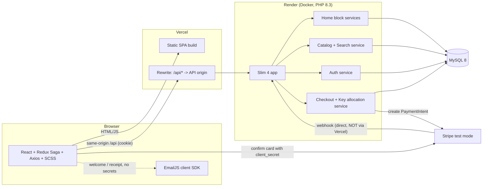
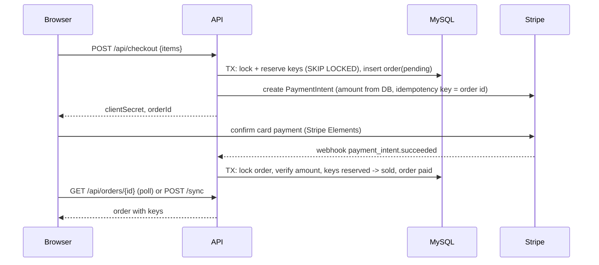

# Architecture

Principle from the brief: **a few features done extensively beat many minimal ones.** So the core
purchase path (search -> product -> cart -> pay -> key) is built to be correct and explainable; everything
around it is cut or stubbed on purpose.

Decisions taken as given: Slim 4, PDO, JWT in an httpOnly cookie via Vercel rewrite, Stripe
PaymentIntent + webhook, EmailJS only for non-secret emails, LIKE + PHP trigram/Levenshtein search.
Where I disagree or tightened them, it is flagged with **CHALLENGE** and summarised in section 9.

---

## 1. Scope

| Area | Status | Justification |
|---|---|---|
| Store: list, filter (platform, region, price), sort, paginate, name search | **In** | Core requirement; filters are SQL `WHERE`s, cheap to do well. |
| Homepage as config-driven blocks (banner, best sellers, deals, new releases) | **In** | Explicit requirement and the best place to show architecture. |
| Fuzzy search + live suggestions | **In** | Explicit; done server-side so it works the same from every page. |
| Product page with multi-seller offer comparison | **In** | Core of a marketplace; offers are the unit that is bought. |
| Cart (server-side, signed-in users) with live pricing | **In** | One truth for prices and stock; the client never sends an amount. |
| Checkout, Stripe PaymentIntent + webhook, key delivery | **In** | The most valuable and riskiest flow; gets the most care and tests. |
| Auth: register, login, logout, me, protected routes | **In** | Required; checkout and orders need identity. |
| Order history with revealed keys | **In** | Required by the flow ("Order and key"). |
| Eneba styling via SCSS modules and design tokens (dark palette, typography, cards, buttons) | **In** | Required; centralised in one theme so it applies to every screen. |
| Keys encrypted at rest (libsodium) | **In** | Small cost, large credibility: a DB dump should not leak sellable keys. |
| Backend integration tests for allocation/concurrency | **In** | The one place where bugs lose money; worth the time. |
| Seller dashboard / key upload | **Out** | Sellers and keys come from a seed script; the buyer side is what is judged. |
| Admin panel, product CRUD | **Out** | Same: seed data is enough to demonstrate everything. |
| Password reset, email verification | **Out** | Reset links are secrets, so EmailJS cannot carry them (see 4); no safe cheap channel. |
| Reviews, wishlist, loyalty, gift cards, coupons | **Out** | No bearing on the core flow; high UI cost. |
| Multi-currency, i18n | **Out** | Single currency (EUR, integer cents) removes a whole class of rounding bugs. |
| Refund UI, disputes | **Out** | Backend can refund automatically in one failure path (see 5); no UI. |
| Real microservices for homepage blocks | **Out** | One PHP app, separate modules/endpoints/tables per block (see 6); infra cost is not worth it. |
| SEO / SSR | **Out** | SPA on Vercel is fine for an assignment; stated as a known limitation. |

---

## 2. System diagram



Key points: the browser only ever talks to its own origin (`/api`), so the cookie is first-party and CORS
is unnecessary. The Stripe webhook goes **directly** to the API origin (it has no cookie, needs the raw
body for signature verification, and must not depend on a proxy). Local dev uses a Vite proxy to mimic the rewrite.

---

## 3. REST API

Conventions: JSON, prices as integer cents + `currency: "EUR"`, errors as
`{ "error": { "code": "string", "message": "string", "details": {} \| null } }` (`details` is always present), pagination as
`{ items, page, pageSize, total }`. Auth column: `-` public, `U` needs cookie. All state-changing
requests require header `X-Requested-With: fetch` (CSRF, see 4).

**Types** (abridged)
`ProductCard = { id, slug, name, coverUrl, platform: {slug,name}, region: {slug,name}, fromPriceCents: number|null, offerCount, inStock, discountPct?, score? }`
(`score` 0..1 only in search results; `fromPriceCents` is `null` and `inStock` false for an out-of-stock product, which only appears in search results)
`Offer = { id, seller: { id, name, rating }, priceCents, originalPriceCents?, stock, deliveryType: "instant" }`
`User = { id, email, displayName }`

Catalog rules (implemented): all prices are integer cents in one currency (EUR), so items carry no `currency` field.
A product is a platform + region listing, so **region lives on the product, not on each offer**. Only *buyable* offers count
(active and at least one available key): `fromPriceCents` is the cheapest of them, `offerCount` their number, and `discountPct`
is the deal on that cheapest offer (key absent when it has none), so price and discount always agree. Products with no buyable
offer are not listed but keep their page (`offers: []`, `fromPriceCents: null`). See `docs/QUERY_PLANS.md`.

| Method | Path | Auth | Request | Response |
|---|---|---|---|---|
| POST | `/api/auth/register` | - | `{ email, password, displayName }` | `201 { user }` + sets cookie. `409 email_taken`, `422` validation |
| POST | `/api/auth/login` | - | `{ email, password }` | `200 { user }` + sets cookie. `401 invalid_credentials` (same message for unknown email) |
| POST | `/api/auth/logout` | - | - | `204`, clears cookie. Public and idempotent; a valid token is also revoked server-side (`token_version` bump) |
| GET | `/api/auth/me` | U | - | `200 { user }` or `401` |
| GET | `/api/products` | - | query: `q` (text search, 1-100 chars), `platform[]` (slug), `region[]` (slug), `genre[]` (name), `price_min`, `price_max` (cents, on the from price), `sort` (`popular` default without `q` \| `price_asc` \| `price_desc` \| `newest` \| `discount` \| `relevance` = default with `q`, 422 without `q`), `page` (>=1), `pageSize` (1-48, default 24). Single values (`platform=steam`) work too | `200 { items: ProductCard[], page, pageSize, total }`; a page past the end is `items: []`. With `q`, items carry `score` and out-of-stock matches are included. `422` on invalid input (details per field) |
| GET | `/api/filters` | - | query: the same filters, including `q` (counts for the search results) | `200 { platforms: [{value,label,count}], regions: [...], genres: [...], price: {min,max} }`. Each facet is counted with all filters except its own; zero-count options are dropped unless selected; `price` is `{min:null,max:null}` when nothing matches |
| GET | `/api/search` | - | same as `/api/products`, but `q` is required | `200 { items: ProductCard[] (with score), page, pageSize, total }`; `422` without `q` |
| GET | `/api/search/suggest` | - | `?q=` (2+ normalised chars, else an empty list) | `200 { suggestions: [{ slug, name, coverUrl, platform: {slug,name}, inStock, score }] }` best 6, out-of-stock included |
| GET | `/api/products/{slug}` | - | - | `200 { product: { ...ProductCard, description, releaseDate, genres[], publisher }, offers: Offer[] }`, offers buyable only, cheapest first. `404 not_found` for an unknown slug |
| GET | `/api/home/layout` | - | - | `200 { blocks: [{ id, type, title, endpoint, config }] }` enabled blocks only, ordered by `position`; `id` is the slug, `config` the row's JSON (`{}` if empty) |
| GET | `/api/home/banners` | - | - | `200 { items: [{ id, imageUrl, title, subtitle, ctaLabel, href }] }`; `404` when the block is disabled |
| GET | `/api/home/best-sellers` | - | - | `200 { items: ProductCard[] }` by units sold, buyable products only, `limit` from the row config (1-50); `404` when disabled |
| GET | `/api/home/deals` | - | - | `200 { items: (ProductCard & { originalPriceCents })[] }` products whose cheapest buyable offer is on an unexpired deal, biggest discount first; `404` when disabled |
| GET | `/api/home/new-releases` | - | - | `200 { items: ProductCard[] }` already released, newest first, buyable only; `404` when disabled |
| GET | `/api/cart` | U | - | `200 { lines: [{ offerId, productSlug, productName, sellerName, unitCents, qty, lineCents, available }], totalCents, currency, issues: [{ offerId, code: "inactive"\|"out_of_stock"\|"insufficient_stock", message }] }`, prices and stock read live |
| POST | `/api/cart` | U | `{ offerId, qty? }` | `201` the cart; `404` unknown offer, `409 insufficient_stock`, `422` qty 1-5 / max 20 lines |
| PATCH | `/api/cart/{offerId}` | U | `{ qty }` | `200` the cart |
| DELETE | `/api/cart/{offerId}` \| `/api/cart` | U | - | `200` the cart (one line removed / emptied) |
| POST | `/api/checkout` | U | none (built from the server-side cart) | `201 { orderId, clientSecret, totalCents, currency, reservedUntil }`. `409 out_of_stock` with `details.items`, `422 cart_empty`, `502 payment_provider_error`, `503 payments_unavailable`. Reserves keys (SKIP LOCKED), creates the PaymentIntent for the server's amount |
| POST | `/api/webhooks/stripe` | Stripe signature | raw Stripe event | `200 { received: true }` after verification (idempotent). `400 invalid_signature`, `503 webhook_not_configured` |
| GET | `/api/orders` | U | `?page, pageSize` | `200 { items: [{ id, status, totalCents, createdAt, itemCount }], page, pageSize, total }` newest first |
| GET | `/api/orders/{id}` | U (owner) | - | `200 { order: { id, status, totalCents, currency, createdAt, reservedUntil? (pending), paidAt? (paid), items: [{ productSlug, productName, sellerName, unitPriceCents, qty, keys?: string[] }] } }`. `keys` present **only** when `status = paid` and the order is the caller's. Others' orders return `404` |
| GET | `/api/images/products/{slug}.svg` | - | - | `200 image/svg+xml` generated cover (stored in `products.cover_svg`), `404` |
| GET | `/api/images/banners/{slug}.svg` | - | - | `200 image/svg+xml` banner artwork, `404` |
| GET | `/api/health` | - | - | `200 { status: "ok", db: "ok" }` |

Status codes: `401` not signed in, `403` wrong owner (we use `404` to avoid leaking ids), `409` stock/state
conflict, `422` validation, `429` rate limited (login, register, checkout, search/suggest; see docs/REVIEW.md S3, S4).

---

## 4. Auth strategy

- **Passwords:** `password_hash(PASSWORD_ARGON2ID)`; never logged; min length 8.
- **Token:** JWT (HS256, `firebase/php-jwt`), claims `sub`, `tv`, `iat`, `exp`. Lifetime 24h, no refresh
  token (one less moving part, stated trade-off).
- **Cookie:** `session=<jwt>; HttpOnly; Secure; SameSite=Lax; Path=/`. JavaScript can never read the token,
  so XSS cannot steal it. The Vercel rewrite makes the API same-origin, so no third-party-cookie problem.
- **CSRF:** `SameSite=Lax` plus a required custom header (`X-Requested-With`) on all non-GET requests and an
  `Origin` check in middleware. A cross-site form cannot set the header.
- **Frontend:** the SPA cannot read the cookie, so it asks `GET /api/auth/me` on boot (a saga) and keeps
  the user in the store. Protected routes redirect to `/login?next=...`. UI guards are convenience only;
  the API enforces `U` on every protected route.
- **Rate limiting (implemented):** failed logins are counted in `login_attempts` (sliding 15 min window): 5 per (IP + email) and 20 per IP, then `429 too_many_attempts` with `retryAfterSeconds`. Unknown emails are counted exactly like real ones, and unknown emails are verified against a dummy hash, so neither status, body nor timing reveals whether an account exists. Registration is limited per address (P15, docs/REVIEW.md S3); the login counters are claimed before the password check so a parallel burst cannot exceed the limit (S4); the client address is read from the right-hand side of `X-Forwarded-For` (S1).
- **Revocation (implemented):** logout bumps `users.token_version`, so the old JWT is dead server-side. Trade-off: this also signs the user out on their other devices.
- **Registration vs enumeration:** `register` answers `409 email_taken`, which does reveal that an email exists. That is the usual trade-off for a clear sign-up UX; login never reveals it.
- **EmailJS:** runs in the browser with a public key, so anything sent through it is public in effect.
  It is used only for a welcome email and an order receipt that says *"your key is in your account"*,
  never the key itself, never reset links.

**CHALLENGE (JWT):** a stateless JWT cannot be revoked, so "log out everywhere" and "password changed" would
not kill old tokens, and a server session row would give the same result with less code. I keep JWT
because you chose it and it is easy to explain, but add a `users.token_version` column: the claim `tv`
must match the DB row, which costs one indexed lookup per request and gives real revocation.

**CHALLENGE (Vercel rewrite):** it works for external destinations but adds a hop and inherits Render
free-tier cold starts (~30-60 s first request). The webhook must bypass it (see 2), and the first page
load should show skeletons rather than hang.

---

## 5. Payment and key allocation

> **As built: see `docs/CHECKOUT.md`** (flow, states, concurrency, failure matrix, Stripe test steps). Differences from the plan below: the cart is server-side (so `POST /api/checkout` has no body), the webhook lives at `/api/webhooks/stripe`, and the `POST /orders/{id}/sync` fallback was not built.

### Data used
`offers` (price, seller) -> `game_keys` (one row per sellable key: `offer_id`, `key_enc`,
`status ENUM('available','reserved','sold')`, `order_id`, `reserved_until`) -> `orders`
(`status ENUM('pending','paid','expired','failed','refund_needed')`, `stripe_pi_id` UNIQUE, `total_cents`,
`reserved_until`) -> `order_items`. `stripe_events(event_id PK)` stores processed webhook ids.

### Flow


1. **Quote and price:** the server recomputes every price from `offers`; the client total is ignored.
2. **Reserve before paying (CHALLENGE):** allocating keys only after `payment_intent.succeeded` can leave a
   customer who paid with nothing to deliver. Instead keys are **reserved at checkout for 15 minutes**.
   In one transaction:
   ```sql
   SELECT id FROM game_keys
   WHERE offer_id = ? AND status = 'available'
   ORDER BY id LIMIT ?            -- qty
   FOR UPDATE SKIP LOCKED;
   -- if fewer rows than qty: ROLLBACK, 409 out_of_stock
   UPDATE game_keys SET status='reserved', order_id=?, reserved_until=? WHERE id IN (...);
   INSERT orders / order_items ...;
   ```
   `FOR UPDATE SKIP LOCKED` (MySQL 8) lets two buyers racing for the last keys get different rows or a
   clean 409, without waiting or deadlocking. Multi-item carts lock offers in ascending `offer_id`
   order to avoid deadlocks. The Stripe call happens **after** the DB commit (never hold row locks across
   a network call); if Stripe fails, a compensating `UPDATE` releases the keys.
3. **Finalize (one function, two callers):** `finalizeOrder(paymentIntentId)` is called by the webhook and by
   `POST /orders/{id}/sync`. In a transaction: `SELECT ... FROM orders WHERE stripe_pi_id=? FOR UPDATE`;
   if already `paid` return (idempotent); verify `amount`, `currency`, `status='succeeded'` against the order;
   `UPDATE game_keys SET status='sold' WHERE order_id=? AND status='reserved'`; if the affected row count is
   not the expected quantity (reservation expired and keys were re-sold), try to allocate fresh keys, and if
   that fails mark `refund_needed` and issue a Stripe refund. Then mark `paid`.
4. **Webhook safety:** verify the signature on the **raw body**, insert `event_id` into `stripe_events`
   (duplicate -> return 200 immediately), handle `payment_intent.succeeded` and
   `payment_intent.payment_failed`/`canceled` (release keys). Stripe retries, so every handler is idempotent.
5. **Expiry without cron (free tier has none):** every checkout runs
   `UPDATE game_keys SET status='available', order_id=NULL WHERE status='reserved' AND reserved_until < NOW()`
   and marks matching orders `expired`, then cancels the PaymentIntent best-effort so a late card
   confirmation cannot succeed.
6. **Key delivery:** keys are decrypted only in `GET /orders/{id}` for the owner when `paid`. They are never
   in a webhook response, log line or email.
7. **Why `/sync` exists (CHALLENGE):** relying on the webhook alone makes the demo fail whenever the webhook is
   delayed, mis-configured or the Stripe CLI is not running. The success page polls the order and calls
   `/sync` once after a few seconds; the result is identical because both paths share `finalizeOrder`.
8. **Tests:** a PHPUnit test fires N parallel reservations at an offer with M<N keys and asserts exactly M
   succeed and no key is assigned twice; another replays the same webhook twice and asserts one delivery.

---

## 6. Homepage block architecture (as built; details in `docs/HOME_BLOCKS.md`)

Requirement: each block has its own backend source; the frontend only renders.

- **Layout in the DB, not the frontend.** Table `home_blocks(slug, type, title, endpoint, position, enabled, config JSON)`.
  `GET /api/home/layout` returns the enabled rows in order as `{ id, type, title, endpoint, config }`. Disabling a row removes the block
  from the layout and its endpoint answers 404 (shown in `HomeTest`).
- **One class, one endpoint, one query set per block** (`App\Home\Blocks\{Banners,BestSellers,Deals,NewReleases}Block`), sharing only the
  `HomeBlock` interface. Each owns its SQL, payload shape and cache (own namespace and TTL: banners 5 min, best sellers 10, deals 2,
  new releases 10). Sources: `banners`; `product_stats.units_sold`; `deals`; `products.release_date`. A reflection test fails the build if
  blocks start sharing a parent, a trait or each other's classes.
- **Adding a block** = one class + one line in `config/home.php` + one `home_blocks` row. The route comes from the class constant.
- **Frontend:** a registry `{ hero: HeroBlock, carousel: ProductCarousel, ... }` maps `type` to a component; each renderer fetches
  `block.endpoint` itself, so a slow or failing block shows its own skeleton/error and never blocks the others. A new block with an existing
  `type` needs no frontend change; a new `type` needs one registered renderer and no new route. No product names, prices or banner text exist in frontend code.
- **CHALLENGE ("separate services"):** still deliberately **not** separate deployables (free tiers cannot host five services). The seam is real,
  though: no block depends on another, so any of them can be extracted by copying one class and the table it reads. The price is some duplicated SQL
  (about 40 lines per product block), accepted on purpose.

---

## 7. Fuzzy search (as built; details, formulas and measurements in `docs/SEARCH.md`)

Used by `GET /api/search`, `GET /api/search/suggest` and `GET /api/products?q=`. Constraint kept: LIKE + PHP re-rank.

**CHALLENGE (still true):** `LIKE '%q%'` alone cannot find typos ("cyberpnuk" matches nothing), so candidate retrieval is fuzzy too.

1. **Normalize** query and `products.name_norm` with the same `TextNormalizer` (lower-case, strip diacritics, drop apostrophes,
   punctuation to space, collapse spaces).
2. **Candidates (SQL, capped at 200):** the whole phrase as a substring, each word as a title/word prefix, and up to 12 inner
   3-letter pieces of the words (the typo net). Ordered by number of matching patterns so the cap keeps the best candidates.
3. **Re-rank (PHP):** `0.50 * tokenScore + 0.30 * trigramScore + bonus` (per-word Levenshtein, partial-word and in-word credit,
   pg_trgm-style trigrams, exact/prefix bonus, penalty when a significant word matches nothing). Scores below 0.40 are dropped.
   Word order does not matter (each query word is matched independently).
4. **Sort and page in SQL:** `sort=relevance` (default when `q` is set) orders by the ranked id list (`FIELD(p.id, ...)`);
   every other sort, all filters, facets and pagination work on the matched set. Filters are applied after the top-200 cut.
5. **Out of stock:** when searching, products without a buyable offer are included (`LEFT JOIN`), flagged `inStock: false`, with
   `fromPriceCents: null`; price filters exclude them and price sorts put them last. Plain browsing still hides them.
6. **Suggest:** same pipeline, best 6, empty list below 2 characters; debounce (250 ms) is the client's job.
7. **Tests:** a 29-row query-to-result table (typos, partial names, word order, diacritics, injection strings, nonsense), unit tests
   of the scoring, and checks on the seeded catalog (see `docs/SEARCH.md`).

Known limits: no synonyms or abbreviations ("gta"), no stemming, hand-tuned weights, a linear-scan SQL pass (about 16 ms at 10k and
145 ms at 100k products in the sandbox). Past ~50k products use a search engine (Meilisearch/Typesense/OpenSearch) or PostgreSQL `pg_trgm`.

---

## 8. Data model (as built)

Auth: `users` (email UNIQUE, argon2id `password_hash`, `token_version`), `login_attempts`.
Catalog: `platforms`, `regions`, `sellers`, `products` (slug, name, `name_norm`, description, genre, publisher,
release_date, platform_id, region_id, `cover_svg`), `offers` (product_id, seller_id, price_cents; UNIQUE per
product+seller), `deals` (offer_id, original_price_cents, discount_pct: **its own source for the deals block**,
replaces the earlier idea of an `original_price_cents` column on offers), `product_stats` (units_sold,
view_count, popularity: source for best sellers and popularity sort), `game_keys` (offer_id, `key_enc`
libsodium-encrypted, `key_hash` sha256 for dedupe, status, order_id, reserved_until).
Homepage: `banners` (with generated `image_svg`), `home_blocks` (slug, type, title, endpoint, position, enabled, config JSON).
Checkout: `cart_items` (user, offer, qty; prices never stored), `orders` (status ENUM pending/paid/failed/expired/canceled/refund_needed/refunded, total, `stripe_payment_intent_id` UNIQUE, `reserved_until`, `paid_at`, `failure_reason`), `order_items` (a name/price snapshot), `stripe_events` (event id PK) and the FK `game_keys.order_id`. All datetimes are UTC.

Plain SQL migrations live in `backend/database/migrations` and are applied by `php bin/migrate.php` (tracked in
`schema_migrations`). `php bin/seed.php` runs them first, then generates deterministic demo data from
`backend/database/seeds` (seeded xorshift RNG): 6 platforms, 5 regions, 12 sellers, 120 products, 2-5 offers each
(about 408), 20-50 keys per offer (about 14.4k, encrypted), about 34 deals, product stats, 4 banners, 4 home blocks.
It is idempotent (upserts by natural key; existing keys and stats are never overwritten, so a sold key stays sold).
Covers and banners are generated SVGs stored in the database and served by the images endpoints, so deployment
needs no file storage. Money is `INT` cents everywhere.

---

## 9. Top 5 risks

| # | Risk | Likelihood / impact | Mitigation |
|---|---|---|---|
| 1 | **Free hosting fit:** Render's free tier has no MySQL and PHP needs a Docker image; cold starts of 30-60 s hit the first user (and any grader). | High / High (no URL = no evaluation) | Decide hosting on day 1 (external free MySQL + Render Docker); deploy a hello-world early; `/api/health` plus a keep-alive ping; skeleton UI. Verify the chosen MySQL supports `SKIP LOCKED`. |
| 2 | **Payment/key race or double delivery** (webhook retries, expired reservations, oversell). | Medium / High | Reserve-then-pay, `FOR UPDATE SKIP LOCKED`, idempotent `finalizeOrder`, `stripe_events` dedupe, `/sync` fallback, concurrency tests (section 5). |
| 3 | **Eneba styling time sink:** pixel-matching eneba.com can eat the whole week and the brief references a design reference I have not seen. | High / Medium | Build the MUI theme (tokens) first, then screens; match structure/colors/typography, not every animation. Get the design reference (question 1). |
| 4 | **Search quality/perf:** LIKE+trigram candidates miss or scan too much; results feel random. | Medium / Medium | Fixture-driven scoring tests, candidate cap, threshold tuning, documented ceiling; keep catalog to a few thousand seed rows. |
| 5 | **Security slips in a security-sensitive flow:** key leakage, CSRF, IDOR on orders, secrets committed, webhook spoofing. | Medium / High | Owner checks returning 404, keys only on `paid` owner reads and encrypted at rest, signature verification, CSRF header + Origin check, `.env` only, `.env.example` committed. |

---

## 10. Assumptions to confirm (questions)

1. **Design reference:** the PDF says "follow the design reference" but none was attached. Do you have it
   (Figma/screens), or should I derive tokens (dark navy/purple palette, typography) from eneba.com directly?
2. **Hosting:** may I assume Vercel (frontend) + Render Docker (API) + an external free MySQL (e.g. Aiven or
   TiDB Cloud)? Which one, and is a ~50 s cold start acceptable for the grader?
3. **Cart (decided: server-side, signed-in users only):** was: is a client-side (persisted) cart with `/cart/quote` OK instead of a server-side cart? A guest
   cart then survives login with no merge logic.
4. **Seed volume:** is roughly 40-60 products, 3-6 sellers and a few keys per offer acceptable, with keys
   being fake strings like `XXXXX-XXXXX-XXXXX`?
5. **Token lifetime:** is 24 h with `token_version` revocation and no refresh token acceptable?
6. **Quantity per line:** may each cart line allow quantity 1-5 (several keys per offer), or one key per
   offer to simplify allocation?
7. **EmailJS scope:** only a welcome email and a key-less receipt, sent from the browser, fine? Or skip
   EmailJS entirely and show on-screen confirmation?
8. **Migration/DI tooling:** plain SQL migrations + PHP-DI with a tiny runner, rather than Phinx/Doctrine?
